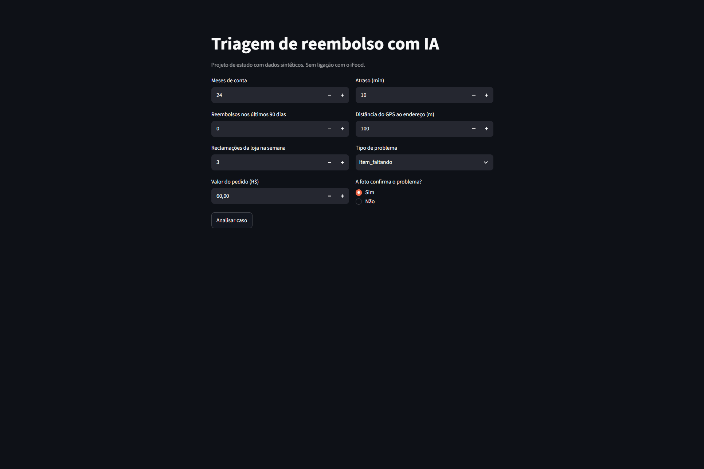
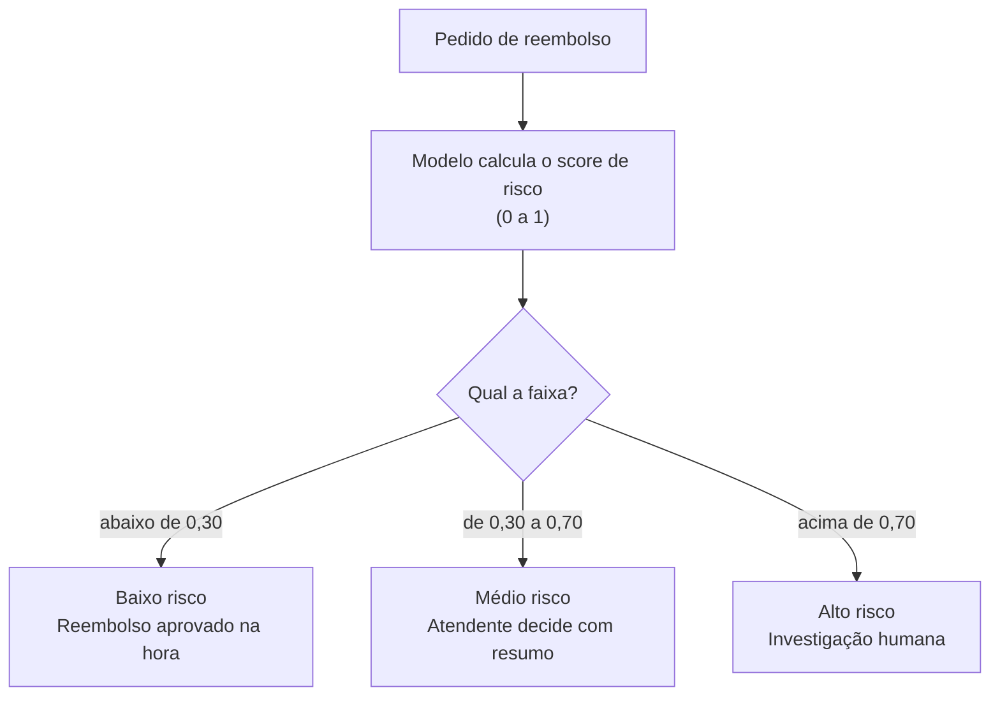

1. O problema: reembolso é a maior fonte de reclamações sobre delivery e já virou ação do Ministério Público de Goiás contra negativas automáticas. https://tribunadoplanalto.com.br/mpgo-vai-a-justica-contra-ifood-e-aponta-falhas-em-entregas-e-reembolsos/

## A solução

Em vez de aprovar ou negar reembolsos automaticamente, o sistema **separa os pedidos por nível de risco**. A IA resolve sozinha apenas os casos claros e encaminha os duvidosos para pessoas, junto com as informações necessárias para decidir rápido.



| Faixa | Score | O que acontece | Quem decide |
| --- | --- | --- | --- |
| Baixo | abaixo de 0,30 | O reembolso é aprovado automaticamente | O sistema |
| Médio | de 0,30 a 0,70 | O caso vai para um atendente, com um resumo gerado por IA | Uma pessoa |
| Alto | acima de 0,70 | O caso vai para investigação | Uma pessoa |

### A regra principal: o sistema nunca nega sozinho

A faixa mais severa é **investigação humana**, nunca uma negativa automática. A IA tem autonomia para **aprovar**, mas não para **punir**.

Essa escolha considera o custo de cada erro:

- **Cliente honesto marcado como suspeito:** custa alguns minutos de um atendente, e o cliente ainda recebe o reembolso.
- **Cliente honesto com reembolso negado automaticamente:** perde o dinheiro, perde a confiança na plataforma e pode recorrer à Justiça. Em 2026, o Ministério Público de Goiás entrou com uma ação justamente contra negativas automáticas de reembolso em apps de delivery.

A regra é garantida por testes automatizados (`tests/test_triagem.py`), que falham se qualquer ação do sistema for uma negativa.

### Como o risco é calculado

Um modelo de **regressão logística** estima a probabilidade de fraude a partir de:

- **Cliente:** tempo de conta e reembolsos nos últimos 90 dias.
- **Loja:** número de reclamações na semana.
- **Pedido:** valor, atraso e tipo de problema.
- **Evidência:** a foto enviada pelo cliente ou, em pedidos **não entregues**, a distância do GPS do entregador até o endereço. Nesses casos a foto é dispensada, já que não há o que fotografar.

### Toda decisão vem com motivos

Para cada caso, o sistema mostra os fatores que mais pesaram, como "Aumenta a suspeita: conta com 2 meses" ou "Reduz a suspeita: a foto confirma o problema". Os motivos são calculados **a partir do próprio modelo** (valor padronizado × coeficiente de cada característica), então a explicação sempre corresponde à decisão.

## Como rodar

### Pré-requisitos

- [Python 3.12 ou mais recente](https://www.python.org/downloads/)
- [Git](https://git-scm.com/)
- Opcional: [Ollama](https://ollama.com/), para gerar os resumos com um LLM local
- Opcional: [Docker](https://www.docker.com/), para rodar tudo em um container

### 1. Baixe o projeto e prepare o ambiente

```bash
git clone https://github.com/SEU-USUARIO/triagem-reembolso-ia.git
cd triagem-reembolso-ia
python -m venv venv
```

Ative o ambiente virtual:

```bash
# Windows
venv\Scripts\activate

# Mac ou Linux
source venv/bin/activate
```

Instale as dependências:

```bash
pip install -r requirements.txt
```

### 2. Gere os dados e treine o modelo

Os dados sintéticos e o modelo não ficam no repositório: eles são criados pelo próprio código.

```bash
python -m src.gerar_dados
python -m src.treinar
```

O primeiro comando cria 5.000 pedidos de reembolso em `data/reembolsos.csv`. O segundo compara dois modelos, mostra as métricas de cada um e salva o escolhido em `modelos/modelo_risco.joblib`.

### 3. Rode os testes

```bash
python -m pytest
```

Os testes conferem, entre outras regras, que o sistema nunca nega um reembolso sozinho.

### 4. Abra a demo

```bash
streamlit run app/demo.py
```

O navegador abre em `http://localhost:8501` com um formulário para testar casos.

### 5. Suba a API

```bash
uvicorn src.api:app --reload
```

A documentação interativa fica em `http://127.0.0.1:8000/docs`, onde dá para testar o endpoint `POST /triagem` direto pelo navegador.

### Opcional: resumos com LLM

Sem configuração extra, o resumo para o atendente é montado a partir de um modelo de texto fixo. Para gerá-lo com um LLM rodando localmente, instale o Ollama e baixe o modelo:

```bash
ollama pull llama3.2
```

Com o Ollama aberto, a demo e a API passam a usar o LLM automaticamente. Se ele estiver indisponível, o sistema volta para o modelo de texto fixo.

### Opcional: Docker

```bash
docker build -t triagem-reembolso .
docker run -p 8501:8501 triagem-reembolso
```

A demo fica disponível em `http://localhost:8501`. O container gera os dados e treina o modelo durante o build.
## Resultados

Os modelos foram avaliados em 1.000 casos de teste (20% dos dados), que não foram usados no treino. Como só cerca de 22% dos casos são fraude (216 de 1.000), as métricas abaixo se referem à **classe fraude**, que é a que importa detectar.

| Modelo | Precision | Recall | F1-score | Acurácia |
| --- | --- | --- | --- | --- |
| **Regressão logística (escolhido)** | 0,42 | **0,75** | **0,54** | 0,72 |
| Floresta aleatória | **0,53** | 0,46 | 0,49 | 0,79 |

- **Precision:** de todos os casos que a regressão logística marcou como suspeitos, 42% eram fraude de verdade. O restante são clientes honestos enviados para revisão humana.
- **Recall:** de todas as fraudes reais, a regressão logística identificou 75%. As demais passariam como baixo risco e seriam aprovadas automaticamente.
- **F1-score:** a média equilibrada entre precision e recall, em que a regressão logística também ficou à frente (0,54 contra 0,49).

Na prática, nos 1.000 casos de teste:

| | Fraudes detectadas | Fraudes que passaram | Honestos enviados para revisão |
| --- | --- | --- | --- |
| Regressão logística | cerca de 162 | cerca de 54 | cerca de 224 |
| Floresta aleatória | cerca de 99 | cerca de 117 | cerca de 88 |

### Por que não usar a acurácia

A floresta aleatória teve acurácia maior (0,79 contra 0,72). Mas 784 dos 1.000 casos de teste são legítimos, então um modelo que classificasse **todos** os casos como legítimos teria 0,78 de acurácia sem detectar nenhuma fraude. A acurácia da floresta é praticamente igual a essa. Com classes desbalanceadas, a acurácia engana, por isso a comparação usa precision, recall e F1 da classe fraude.

### Por que a regressão logística

A regressão logística teve F1-score maior e detectou muito mais fraudes (75% contra 46%). Em troca, enviou mais clientes honestos para revisão.

Neste sistema, um caso suspeito vai para revisão humana em vez de ser negado. Então os erros têm custos diferentes:

- **Marcar um honesto como suspeito** custa alguns minutos de um atendente, e o cliente ainda recebe o reembolso.
- **Deixar uma fraude passar** significa um reembolso aprovado automaticamente, sem ninguém olhar.

Por isso, o recall pesa mais na escolha. A regressão logística também tem outra vantagem: seus coeficientes permitem explicar cada decisão, o que é usado para gerar os motivos exibidos ao atendente.

### Limite esperado de desempenho

Os rótulos dos dados sintéticos foram sorteados a partir de uma probabilidade, o que cria casos "inesperados", como suspeitos legítimos e inocentes fraudulentos. Nenhum modelo consegue prever esse sorteio, então há um teto de desempenho. Além disso, como os dados foram gerados com uma fórmula logística, era esperado que a regressão logística fosse competitiva.
## Limitações

Este é um projeto de estudo, e os resultados devem ser lidos com estas ressalvas:

### Dados sintéticos

Os 5.000 pedidos foram gerados por código, e as regras que definem o que é fraude (os pesos de cada característica) são **suposições minhas**, não padrões observados em dados reais. O modelo aprendeu a redescobrir essas regras. Por isso, as métricas mostram que o pipeline funciona, mas **não indicam como ele se sairia com dados reais** de uma plataforma de delivery.

### Foto simulada

A foto é representada por um campo binário (`foto_compativel`: 1 ou 0), como se outra etapa já tivesse analisado a imagem. Num sistema real, essa informação viria de verificações como detecção de fotos reaproveitadas, comparação com o item pedido e identificação do problema na imagem. Além disso, uma foto é uma evidência fraca para alguns tipos de problema: em "item faltando", por exemplo, basta retirar o item da sacola antes de fotografar.

### Explicações com limites

Os motivos exibidos vêm das contribuições do modelo (valor padronizado × coeficiente), o que garante que a explicação corresponda à decisão. Mas esse método tem limites:

- As contribuições são **relativas a um caso médio**. "Reduz a suspeita: pedido de R$ 40,00" significa que o valor está abaixo da média, não que pedidos baratos sejam sempre confiáveis.
- A regressão logística soma as características de forma independente e **não captura combinações**. Por isso, o alerta de "GPS na porta em pedido não entregue" é uma regra fixa, exibida à parte.

### Risco de viés por região e perfil

Os dados sintéticos não têm informações de região, mas, num cenário real, várias características usadas aqui podem carregar desigualdades:

- **Distância do GPS e atraso** podem ser piores em áreas periféricas, com endereços mais difíceis de encontrar.
- **Reclamações da loja** variam conforme a região e o tipo de estabelecimento.
- **Qualidade da foto** depende do celular: fotos de aparelhos mais simples, com pouca luz, poderiam ser lidas como "não confirma o problema".

Um modelo treinado com dados reais poderia aprender a desconfiar mais de certos bairros ou perfis de renda. Antes de qualquer uso real, seria necessário **auditar os resultados por região e perfil** e corrigir as distorções encontradas.

### Limites das faixas definidos manualmente

Os limites de 0,30 e 0,70 foram escolhidos por mim. Num sistema real, eles seriam definidos com base no custo de cada tipo de erro e na **capacidade da equipe de atendimento**: se a faixa média recebe mais casos do que os atendentes conseguem revisar, o sistema cria filas e atrasos.

### Compensação da foto em pedidos não entregues

Para não deixar pedidos "não entregues" mais suspeitos apenas por não terem foto, os dados aplicam uma compensação igual ao efeito médio da foto nos outros tipos. É uma decisão de equidade razoável, mas também é uma suposição, e precisaria ser validada com dados reais.

### Resumo gerado por LLM

O resumo para o atendente usa um modelo pequeno, rodando localmente, que pode cometer erros de português ou de interpretação. A validação aplicada é simples (tamanho e presença de palavras em inglês). Por isso, o resumo é apenas um apoio: as informações que precisam estar sempre corretas (faixa, ação e motivos) são geradas sem o LLM.

### Sem monitoramento

O modelo é treinado uma única vez. Em produção, os padrões de fraude mudam com o tempo, e quem frauda se adapta ao que o sistema aceita. Um sistema real precisaria de monitoramento contínuo e retreino periódico.
## Próximos passos

Melhorias planejadas, em ordem de prioridade:

### 1. Análise real de imagens

Substituir o campo simulado `foto_compativel` por um score calculado a partir da imagem, em etapas:

- **Fotos reaproveitadas:** comparar a foto enviada com fotos de reembolsos anteriores usando hash perceptual (biblioteca `imagehash`), que reconhece a mesma imagem mesmo recortada ou com outro brilho.
- **Foto do pedido certo:** usar um modelo de visão e linguagem, como o CLIP, para medir se a imagem combina com a descrição do item pedido.
- **Problema visível:** classificar o que a foto mostra (comida derramada, embalagem violada, item faltando) e comparar com o texto da reclamação.

Para controlar o custo, as verificações rodariam em cascata: primeiro as mais baratas, e os modelos mais pesados só nos casos duvidosos. Fotos de baixa qualidade iriam para revisão humana, sem contar contra o cliente.

### 2. Explicações com SHAP para modelos mais complexos

Hoje, os motivos usam os coeficientes da regressão logística, o que não funciona para modelos como a floresta aleatória. Com a biblioteca **SHAP**, seria possível testar modelos capazes de capturar combinações entre características (como "não entregue" + "GPS na porta") sem perder a explicação de cada decisão.

### 3. Auditoria de viés

Adicionar aos dados características como região e faixa de renda e medir se as taxas de casos marcados como suspeitos mudam entre grupos com o mesmo comportamento. Se houver diferença, ajustar o modelo ou os limites antes de qualquer uso real.

### 4. Monitoramento do modelo

Em produção, acompanhar continuamente:

- **Mudança nos dados:** se o perfil dos pedidos (valores, tipos de problema, distâncias) se afasta do que foi usado no treino.
- **Desempenho:** usar as decisões dos atendentes como rótulos para recalcular precision e recall com casos reais.
- **Volume por faixa:** se a faixa média recebe mais casos do que a equipe consegue revisar.

Quando o desempenho cair, o modelo seria retreinado com os dados mais recentes.

### 5. Limites das faixas baseados em custo

Definir os limites de 0,30 e 0,70 a partir do custo de cada tipo de erro e da capacidade da equipe de atendimento, em vez de valores fixos escolhidos manualmente.

### 6. Avaliação do resumo gerado por LLM

Criar um conjunto de casos de teste com resumos de referência e medir automaticamente erros de português, informações inventadas e omissões, para comparar modelos e prompts de forma objetiva.
## Aviso

Este é um **projeto pessoal de estudo**, criado para praticar machine learning, APIs e IA generativa aplicados a um problema real.

- O projeto **não tem nenhuma ligação, parceria ou endosso do iFood** ou de qualquer outra plataforma de delivery. O nome iFood é citado apenas como contexto, e é uma marca de seus respectivos titulares.
- **Todos os dados são sintéticos**, gerados por código. Nenhum dado real de clientes, restaurantes ou entregadores foi usado.
- As informações sobre o problema (reclamações e ações judiciais) vêm de **fontes públicas**, citadas na seção "O problema".
- O sistema **não deve ser usado em produção**: as limitações descritas acima precisariam ser resolvidas antes de qualquer uso real.
## Autor

**Leonardo Santiago Batista**
Estudante de Análise e Desenvolvimento de Sistemas na UniCesumar

- LinkedIn: (https://www.linkedin.com/in/leonardo-santiago-648ab0409/)
- E-mail: lsantiago12113@gmail.com