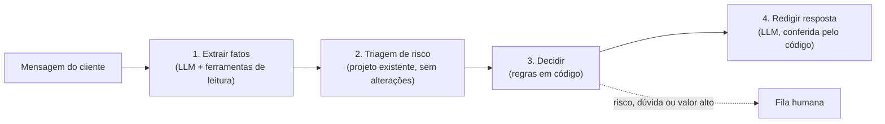

# Agente de atendimento com IA

Extensão do projeto de [triagem de reembolso](../README.md). O agente recebe a mensagem de um cliente sobre um problema com o pedido, consulta o pedido, aciona a triagem existente e devolve uma resposta específica e justificada. Quando não há segurança suficiente, ele encaminha o caso para uma pessoa.

O alvo são as duas reclamações mais comuns sobre atendimento de delivery: reembolso negado sem explicação e resposta genérica que não trata do problema.

## A ideia principal: o LLM conversa, o código decide

O modelo de linguagem participa só das pontas: extrai os fatos da mensagem e redige a resposta. **Aprovar, negar e calcular o valor do reembolso são decididos por regras em código** e pela triagem. Assim a decisão é auditável, e o LLM não tem como inventar valores.



| Etapa | Quem faz | O que garante |
| --- | --- | --- |
| Extrair fatos | LLM (Ollama local) | Ferramentas só de leitura e presas ao pedido do chamado: o cliente não consegue fazer o modelo consultar outro pedido |
| Triagem | Modelo de risco existente | Faixa baixa segue; faixa média ou alta vai para uma pessoa |
| Decidir | Código (`policy.py`) | Valor calculado a partir dos preços do pedido, nunca do texto; reembolso no meio de pagamento original |
| Redigir | LLM | A resposta é conferida contra a decisão; se citar outro valor ou prometer o que não foi decidido, vira um texto padrão |

### Integração com a triagem

A triagem entra **intacta**, por trás de uma interface:

- **No Docker**, roda como serviço HTTP próprio (`POST /triagem`), com a mesma imagem do projeto original.
- **Em desenvolvimento**, pode ser chamada direto no processo.

O agente converte a saída da triagem (`score`, `faixa`, `motivos`) para o seu formato. Como a triagem nunca nega, o risco aparece como alerta, e a decisão final fica com as regras.

## Como rodar

### Com Docker (recomendado)

Pré-requisitos: Docker Desktop. Com GPU NVIDIA a análise leva cerca de 3 segundos; sem GPU, comente o bloco `deploy` do serviço `ollama` no `docker-compose.yml`.

```bash
cd agente-atendimento
docker compose up -d --build
```

Na primeira vez, o modelo `qwen2.5:7b` (cerca de 4,7 GB) é baixado. Depois disso:

- **Tela do agente:** http://localhost:8502
- **API:** http://localhost:8000/docs

Para parar: `docker compose down`.

### Sem Docker

```bash
cd agente-atendimento
python -m venv ~/.venvs/agente-atendimento
# ative o venv e então:
pip install -e ".[dev,local-triage]"
pytest
```

O venv fica fora do repositório para não entrar na imagem Docker da triagem.

## Resultados

Conjunto de avaliação em `tests/eval/cases.jsonl`, rodado com `python tests/eval/run_eval.py`:

| Modelo | Acerto de decisão | Aprovações indevidas | Latência p95 |
| --- | --- | --- | --- |
| `qwen2.5:7b` (GPU) | 86% | 0 | 3 s |
| `llama3.2` | 29% | 0 | 8 s |

"Aprovação indevida" é reembolso aprovado quando o esperado era outra ação. É a métrica que importa: qualquer valor acima de zero significa dinheiro saindo errado. Os erros que restam caem para o lado seguro: o agente pede mais informação ou encaminha para uma pessoa.

O conjunto tem só 7 casos, então cada caso vale cerca de 14 pontos de acerto. O próximo passo é ampliá-lo para uns 50.

## Limitações

- **Dados sintéticos.** Pedidos e sinais de risco (histórico do cliente, reclamações da loja, GPS, foto) são falsos; não há acesso a dados reais.
- **Foto não analisada.** O agente só registra se o cliente diz ter foto; a triagem recebe "foto não confirmada" até existir análise de imagem.
- **Avaliação pequena.** 7 casos não bastam para calibrar prompt, modelo e limites com segurança.
- **Sem persistência.** As decisões ficam em memória; em produção iriam para um banco, com o modelo e a versão do prompt usados.

## Aviso

Projeto pessoal de estudo. **Não tem ligação, parceria ou endosso do iFood** ou de qualquer outra plataforma de delivery. Todos os dados são sintéticos, e o sistema não deve ser usado em produção.
